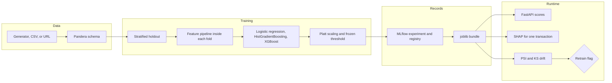
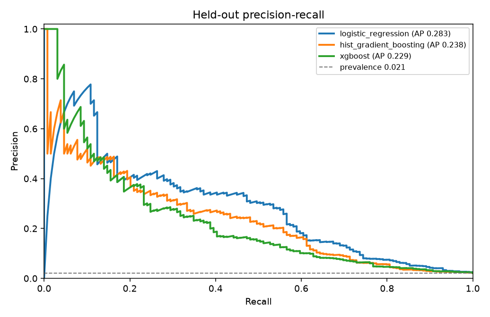

# PayGuard

PayGuard is an end-to-end MLOps project for payment-card fraud detection. It generates a reproducible transaction table, checks the schema, compares a logistic regression baseline with two gradient-boosting models, tracks the runs in MLflow, and serves the selected model through a small FastAPI service with SHAP explanations and a drift trigger.

The numbers in this README come from one pipeline run: `python -m payguard.pipeline --config configs/train.yaml`, seed 42, 30,000 synthetic transactions, on 20 November 2026. The full payload is `reports/metrics.json`. Nothing in the table below was typed in by hand from memory.

Author: Ashwath Bajaj.

## Problem

A fraud reviewer cannot look at every card transaction. The useful model is one that ranks rare fraud above ordinary spend, then flags a small queue whose precision is high enough to be worth a person's time.

Accuracy is the wrong score. On this run, 97.86% of transactions are legitimate, so a model that never flags anyone is 97.86% accurate and useless. The pipeline therefore selects on average precision (PR-AUC) and ships a threshold that maximises recall subject to a precision floor.

The training table is synthetic. The public ULB/Kaggle card-fraud file is large, credential-gated, and anonymised into PCA components, which makes a SHAP conversation hard to follow. `src/payguard/data/generate.py` draws interpretable payments from a known process (amount spikes, online foreign purchases, a new device at night, and a few interactions) and then adds a little label noise. `src/payguard/data/load.py` can also read a local CSV or download a URL, and it falls back to the generator if the download fails, so CI does not need a network.

## Architecture



Schema checks and drift checks answer different questions. A row with a negative amount never reaches the model. A row that is valid but comes from a shifted population can still be scored, and the monitor decides whether that population is different enough to retrain.

## Quickstart

```bash
python -m venv .venv
source .venv/bin/activate
pip install -e ".[dev]"
make train
make test
make serve
```

`make train` writes:

- `models/model.joblib`, the bundle the API loads
- `reports/metrics.json`, the numbers below
- `reports/plots/pr_curves.png`, `calibration.png`, `shap_summary.png`
- `reports/drift_report.md`
- a local MLflow store at `sqlite:///mlflow.db` and artifacts under `mlartifacts/`

The API is then:

```bash
curl -s http://127.0.0.1:8000/health
curl -s http://127.0.0.1:8000/predict \
  -H 'content-type: application/json' \
  -d @reports/sample_request.json
```

Scored against the committed bundle, the grocery/swipe sample in `reports/sample_request.json` returns fraud probability **0.009044** and `fraud_flag: false` (threshold **0.256165**). A hand-built high-risk transaction (online, foreign, new device, night, gambling, high amount versus recent average) returns probability **0.999745** and `fraud_flag: true`.

MLflow and the API together:

```bash
docker compose up --build
```

The API container reads `./models` and does not call MLflow on the request path. MLflow is the experiment UI and the model registry (`payguard-fraud-detector`, version 1 for this run, run id `49fe7559f07b43e9abd657a0a85a3f5e`).

## Results

Held-out test set: 6,000 transactions, fraud rate 0.0215. The prevalence baseline for PR-AUC is that same rate. Selection uses pooled out-of-fold PR-AUC on the 24,000 training rows, not the test set.

| Model | OOF PR-AUC | Fold PR-AUC | Test PR-AUC | Test ROC-AUC | Test recall | Test precision | Test Brier, calibrated |
| --- | ---: | ---: | ---: | ---: | ---: | ---: | ---: |
| logistic_regression | 0.223 | 0.230 ± 0.019 | 0.283 | 0.870 | 0.171 | 0.407 | 0.018 |
| hist_gradient_boosting | 0.156 | 0.166 ± 0.030 | 0.238 | 0.823 | 0.147 | 0.475 | 0.018 |
| xgboost | 0.160 | 0.168 ± 0.027 | 0.229 | 0.820 | 0.101 | 0.542 | 0.019 |

`logistic_regression` wins the selection metric. Test PR-AUC of 0.283 is 0.283 / 0.0215 ≈ 13.2 times the prevalence baseline. The precision floor is 0.40. On out-of-fold scores the floor is met at threshold 0.256 (86 true positives, 129 false positives, recall 0.167). Frozen and applied to the test set, that threshold flags 0.9% of transactions: 22 true positives, 32 false positives, 107 false negatives, 5,839 true negatives. Test precision is 0.407.

Class weighting makes the raw logistic probabilities far too high. Platt scaling, fit on out-of-fold scores only, moves test Brier from 0.146 to 0.018 and expected calibration error from 0.315 to 0.007.




Global SHAP on 1,500 training rows, in the model margin, puts `log_amount` first (mean absolute SHAP 0.538), then `channel_online` (0.240), `device_trust_trusted` (0.120), `txn_count_24h` (0.112), and `country_match_foreign` (0.109). Those are the mechanisms the generator actually uses.

A second synthetic draw from the same process has prediction PSI 0.004 and does not trip the retrain rule. A deliberately shifted draw (larger amounts, more online and foreign and new-device traffic, higher velocity) has prediction PSI 6.135 and flags eight features. The rule says retrain. It does not launch a training job by itself.

## Design decisions

**Interpretable synthetic payments, with a CSV and URL loader.** The generator is deterministic for a seed, which is why this table can be reproduced. A download failure falls back to it so GitHub Actions stays offline. Point `data.source` at `csv` or `url` when you have an extract with the same columns.

**Weights, not SMOTE.** SMOTE invents rows and, if it is fit before the split, leaks. `class_weight="balanced"` on logistic regression and histogram gradient boosting, and `scale_pos_weight` on XGBoost, keep the original rows and the original prevalence. The threshold, not the sampler, decides how many alerts the queue gets.

**The feature pipeline is fit inside each fold.** `TransactionFeatureBuilder` only adds row-wise fields (`log_amount`, amount-to-average ratio, night, velocity, foreign-and-online, new-device-at-night). Imputation, scaling, and one-hot categories are fit on the fold's training rows. The same preprocessor object is what serving uses after a final fit on all training rows.

**PR-AUC picks the model. A precision floor picks the threshold.** Average precision judges the ranking. The business constraint is "don't show reviewers a queue that is mostly clean." `recall_at_precision` in `src/payguard/training/metrics.py` takes the highest recall whose precision is at least 0.40, using calibrated out-of-fold scores. The test set is scored once with that frozen threshold.

**Why 0.40 and not 0.70.** A 0.70 floor is reachable on this data, but only by flagging a few dozen training rows. That threshold moves around. 0.40 still concentrates fraud (about 19 times the 2.1% base rate) and is estimated from 215 out-of-fold alerts.

**Why the linear model won.** The feature builder already includes the interactions that the generator uses. Given those columns, extra trees did not improve out-of-fold PR-AUC. Histogram gradient boosting and XGBoost stay in the comparison because a real feed will have structure nobody wrote down as a feature. The winner is whichever model has the best out-of-fold PR-AUC, not whichever one is more fashionable.

**Platt scaling on out-of-fold scores.** A monotone map does not change PR-AUC. It does change Brier score, calibration error, and the threshold. The calibrator is a logistic regression on the logit of the raw score, fit only on out-of-fold predictions, then applied to the refit model.

**joblib for serving, MLflow for history.** The request path loads one local bundle: preprocessor, model, calibrator, threshold, SHAP background, and the metric snapshot. MLflow records parameters, metrics, plots, and a pyfunc wrapper registered as `payguard-fraud-detector`. Scoring does not depend on the tracking server being up.

**PSI and KS, implemented here.** `src/payguard/monitoring/drift.py` bins the reference sample by its own quantiles and computes population stability index, plus a Kolmogorov-Smirnov statistic for numeric columns and for the score. The rule in `configs/train.yaml` retrains the flag when two or more features have PSI at least 0.20, or when prediction PSI is at least 0.10. Those cutoffs are the usual industry bands, and they are config, not magic.

## Layout

```text
configs/                 train.yaml and the smaller ci.yaml
src/payguard/data/       generator, loader, Pandera schema
src/payguard/features/   row-wise features and the sklearn preprocessor
src/payguard/training/   models, metrics, cross-validation
src/payguard/scoring.py  raw scores and Platt scaling
src/payguard/tracking.py MLflow runs and the registry
src/payguard/explain/    global and single-row SHAP
src/payguard/monitoring/ PSI, KS, and the retrain rule
src/payguard/serving/    FastAPI, pydantic schemas, MLflow pyfunc
src/payguard/pipeline.py CLI
tests/                   data, features, metrics, drift, model, API
.github/workflows/ci.yml ruff, pytest, and a small training run
docs/PROJECT_EXPLAINER.md  interview walk-through, plus the PDF
```

## API

| Method | Path | Purpose |
| --- | --- | --- |
| GET | `/health` | Process is up, and whether the bundle loaded |
| GET | `/model` | Name, version, threshold, stored metrics |
| POST | `/predict` | One transaction |
| POST | `/predict/batch` | Up to 1,000 transactions |
| POST | `/explain` | Score plus the eight largest SHAP contributions |

Invalid amounts and unknown categories fail validation with HTTP 422 before the model sees them. A missing bundle returns 503 from the scoring routes and `status: degraded` from `/health`.

SHAP values are in the model's margin (log-odds), not in percentage points of the calibrated probability. The `/explain` payload says so.

## Tests and CI

```bash
make lint
make test
make ci
```

`make ci` uses `configs/ci.yaml` (2,500 rows, 3 folds, fewer trees) and writes under `models/ci/` and `reports/ci/`, so it does not overwrite the report committed from the full run. GitHub Actions runs ruff, pytest, and that small training job on Python 3.11.

## Roadmap

- Train on issuer data with delayed labels, and measure precision at the time the alert is worked, not at authorisation time.
- Replace the precision floor with an explicit cost: loss given fraud versus the cost of a review.
- Champion/challenger serving, with the challenger in shadow until its out-of-fold PR-AUC wins.
- A scheduled job that turns the retrain flag into a new registered version, instead of only a report.
- Monitoring on live windows rather than a simulated shift, including expected calibration error over time.

## License

MIT. See `LICENSE`.
