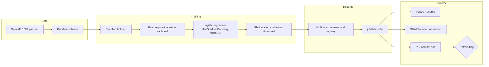
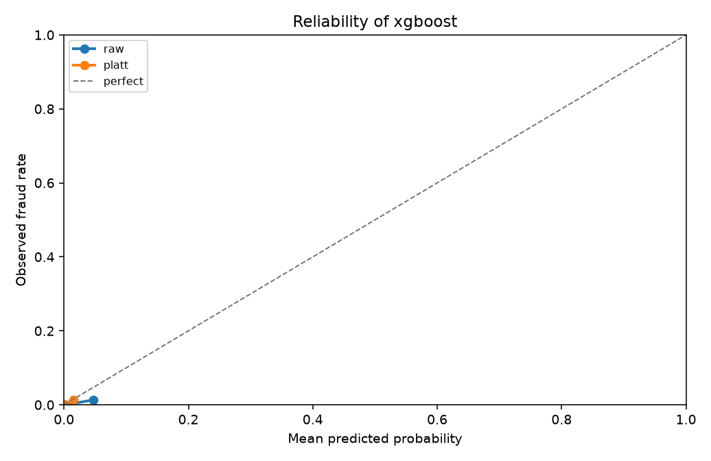
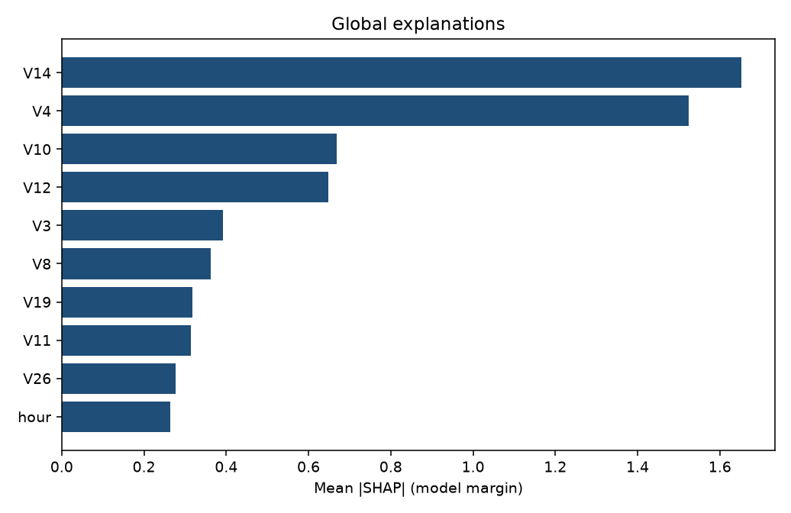

# PayGuard

PayGuard is an end-to-end MLOps project for payment-card fraud detection. It loads a public transaction table, checks the schema, compares a logistic regression baseline with two gradient-boosting models, tracks the runs in MLflow, and serves the selected model through FastAPI with SHAP explanations and a drift trigger.

The numbers in the results table come from one run of `python -m payguard.pipeline --config configs/train.yaml` on 20 November 2026. That run loaded the full OpenML credit-card table (dataset 1597). The payload is `reports/metrics.json`. CI does not recompute these numbers. It trains on a small committed sample of the same table so the job can run offline.

Author: Ashwath Bajaj.

## Dataset

| | |
| --- | --- |
| Name | `creditcard` |
| Source | [OpenML dataset 1597](https://www.openml.org/d/1597), the ULB / Worldline credit-card fraud table |
| File used for the reported run | OpenML parquet `https://data.openml.org/datasets/0000/1597/dataset_1597.pq` |
| Licence | Public |
| Origin | European cardholders, September 2013, two days of transactions. Collected by the Machine Learning Group at ULB with Worldline. |
| Citation | Andrea Dal Pozzolo, Olivier Caelen, Reid A. Johnson and Gianluca Bontempi. Calibrating Probability with Undersampling for Unbalanced Classification. Symposium on Computational Intelligence and Data Mining (CIDM), IEEE, 2015. |
| Rows loaded | 284,807 |
| Frauds | 492 (0.1727%) |
| Legitimate | 284,315 |
| Features | `Time` (seconds since the first transaction), `Amount`, and `V1`–`V28` (principal components). The label in the file is `Class`; the pipeline stores it as `fraud`. |

`sklearn.datasets.fetch_openml` was tried as well. On this date the ARFF mirror failed its published md5 check, so the loader uses the parquet file listed on the same OpenML record, and calls `fetch_openml` only if that download fails.

The pipeline then adds three row-wise fields: `log_amount`, `hour` (from `Time` modulo one day), and `is_night`. There is no customer id in this table, so there is no honest velocity or "trailing average spend" feature.

**Which run is which**

- README table, `reports/metrics.json`, `reports/plots/`, and `models/model.joblib`: the full 284,807-row OpenML table.
- `data/samples/creditcard_ci.csv` and `configs/ci.yaml`: a stratified subset of that same table, 80 frauds and 1,920 legitimate transactions (2,000 rows, fraud rate 4%). Real rows, committed so GitHub Actions does not download anything. Not the source of the table below.
- `payguard.data.generate`: a synthetic generator with the same column names, used by the unit tests and only if both the parquet download and the sample file are unavailable. Not the source of the table below.

## Problem

A reviewer cannot look at every card transaction. Here 99.83% of rows are legitimate, so a model that never flags anyone is 99.83% accurate and useless. The pipeline selects on average precision (PR-AUC) and ships a threshold that maximises recall subject to a precision floor of 0.50, chosen on out-of-fold scores.

## Architecture



Schema checks and drift checks answer different questions. A negative amount never reaches the model. A legal row from a shifted population can still be scored, and the monitor decides whether that population has moved enough to retrain.

## Quickstart

```bash
python -m venv .venv
source .venv/bin/activate
pip install -e ".[dev]"
make train
make test
make serve
```

`make train` downloads the OpenML parquet on the first run (cached at `data/raw/creditcard.pq`) and writes:

- `models/model.joblib`, the bundle the API loads
- `reports/metrics.json`, the numbers below
- `reports/plots/pr_curves.png`, `calibration.png`, `shap_summary.png`
- `reports/drift_report.md`
- a local MLflow store at `sqlite:///mlflow.db`

```bash
curl -s http://127.0.0.1:8000/health
curl -s http://127.0.0.1:8000/predict \
  -H 'content-type: application/json' \
  -d @reports/sample_request.json
```

Scored with the committed bundle, the held-out legitimate row in `reports/sample_request.json` (Amount 23.00, Time 160760) returns fraud probability **0.000088** and is not flagged. A held-out fraud from the same split (Amount 0.01, Time 57007) returns probability **0.969684** and is flagged. The threshold is **0.020246**.

MLflow and the API together:

```bash
docker compose up --build
```

The API reads `./models` and does not call MLflow on the request path. This run registered `payguard-fraud-detector` version 1, MLflow run `5055c3c29a1b4f8d8841f1551c633a3e`.

## Results

Held-out test set: 56,962 transactions, 98 frauds, fraud rate 0.00172. The prevalence baseline for PR-AUC is that rate. Selection uses pooled out-of-fold PR-AUC on the 227,845 training rows.

| Model | OOF PR-AUC | Fold PR-AUC | Test PR-AUC | Test ROC-AUC | Test recall | Test precision | Calibrated Brier |
| --- | ---: | ---: | ---: | ---: | ---: | ---: | ---: |
| logistic_regression | 0.746 | 0.749 ± 0.053 | 0.724 | 0.973 | 0.878 | 0.497 | 0.00062 |
| hist_gradient_boosting | 0.756 | 0.776 ± 0.010 | 0.726 | 0.969 | 0.878 | 0.331 | 0.00071 |
| xgboost | 0.834 | 0.837 ± 0.023 | 0.850 | 0.982 | 0.888 | 0.360 | 0.00051 |

`xgboost` wins the selection metric. Test PR-AUC of 0.850 is 0.850 / 0.00172 ≈ 494 times the prevalence baseline.

The precision floor is 0.50. On out-of-fold scores XGBoost meets it: threshold 0.0202, precision 0.501, recall 0.850, 335 true positives and 334 false positives. Frozen and applied to the test set, that threshold flags 0.425% of transactions: 87 true positives, 155 false positives, 11 false negatives, 56,709 true negatives. Test precision is 0.360, below the floor. The ranking generalised; the exact operating point did not. Logistic regression's test precision stayed closer to the floor (0.497) but its test PR-AUC is 0.724, so it was not selected.

Class weighting pushes logistic probabilities up. Platt scaling, fit on out-of-fold scores only, moves its test Brier from 0.0240 to 0.00062 and its expected calibration error from 0.070 to 0.00018. XGBoost was already closer: test Brier 0.00145 to 0.00051, ECE 0.00480 to 0.00043.






Global SHAP on 1,500 training rows, in the model margin, ranks `V14` first (mean absolute SHAP 1.651), then `V4` (1.523), `V10` (0.669), `V12` (0.649), and `V3` (0.392). These are principal components. The explanation says which anonymous directions the model uses. It cannot name a merchant or a country, because those fields are not in the public table. `hour`, which we derived from `Time`, is tenth (0.264).

A second sample from the same test distribution has prediction PSI 0.0066 and does not trip the retrain rule. The same rows after a scripted shift (larger amounts, `Time` moved by 12 hours, and offsets on `V1`–`V4` and `V14`) have prediction PSI 3.808 and flag `Time`, `Amount`, `V1`, `V2`, `V3`, `V4`, and `V14`. The rule says retrain. It does not launch a training job by itself.

## Design decisions

**The public ULB table, not a synthetic population, is what we report.** The columns are the ones the issuer-side researchers could publish: two raw fields and 28 principal components. That is less friendly for a customer-facing explanation than named fields, and it is the real measurement.

**A small real sample for CI, a generator only as a last resort.** `data/samples/creditcard_ci.csv` keeps the offline job on real rows. The generator in `src/payguard/data/generate.py` emits the same columns so tests and a failed download still produce a valid frame. Its labels are not the ULB labels.

**Weights, not SMOTE.** `class_weight="balanced"` on logistic regression and histogram gradient boosting, and `scale_pos_weight` on XGBoost, keep every real transaction. The threshold, not a sampler, decides the queue.

**The feature pipeline is fit inside each fold.** `TransactionFeatureBuilder` only adds `log_amount`, `hour`, and `is_night`. Median imputation and scaling are fit on the fold's training rows. Serving uses the preprocessor fit on all training rows.

**PR-AUC picks the model. A precision floor picks the threshold.** `recall_at_precision` takes the highest recall whose out-of-fold precision is at least 0.50. The test set is scored once with that frozen threshold. On this run the test precision of the winner landed at 0.360. That is reported as a miss against the floor, not adjusted away.

**Why XGBoost won.** The useful signal is spread across principal components. A linear model with scaled components still reaches out-of-fold PR-AUC 0.746. XGBoost reaches 0.834. The fold standard deviations (0.023 and 0.053) do not turn that into a tie.

**Platt scaling on out-of-fold scores.** A monotone map does not change PR-AUC. It changes Brier score, calibration error, and the probability we threshold. For XGBoost the raw scores were already fairly sharp; for logistic regression the correction is large.

**joblib for serving, MLflow for history.** The request path loads one local bundle. MLflow records parameters, metrics, plots, and a pyfunc wrapper registered as `payguard-fraud-detector`.

**PSI and KS, implemented here.** Bins are the reference quantiles. The rule in `configs/train.yaml` raises the retrain flag when two or more features have PSI at least 0.20, or when prediction PSI is at least 0.10. The stable control is another draw from the same real table, not a draw from the synthetic generator. Comparing those two would look like drift even when the card population had not moved.

## Layout

```text
configs/train.yaml          full OpenML run
configs/ci.yaml             offline sample
data/samples/creditcard_ci.csv
src/payguard/data/          OpenML loader, generator, Pandera schema
src/payguard/features/      log amount, hour, scaling
src/payguard/training/      models, metrics, cross-validation
src/payguard/scoring.py     raw scores and Platt scaling
src/payguard/tracking.py    MLflow runs and the registry
src/payguard/explain/       global and single-row SHAP
src/payguard/monitoring/    PSI, KS, and the retrain rule
src/payguard/serving/       FastAPI, pydantic schemas, MLflow pyfunc
src/payguard/pipeline.py    CLI
tests/                      data, features, metrics, drift, model, API
docs/PROJECT_EXPLAINER.md   interview walk-through, plus the PDF
```

## API

| Method | Path | Purpose |
| --- | --- | --- |
| GET | `/health` | Process is up, and whether the bundle loaded |
| GET | `/model` | Name, version, threshold, stored metrics |
| POST | `/predict` | One transaction (`Time`, `Amount`, `V1`–`V28`) |
| POST | `/predict/batch` | Up to 1,000 transactions |
| POST | `/explain` | Score plus the eight largest SHAP contributions |

A negative amount or an unknown field is HTTP 422. A missing bundle is HTTP 503 on the scoring routes and `status: degraded` from `/health`.

SHAP values are in the model's margin (log-odds), not in percentage points of the calibrated probability. On this dataset they refer to principal components.

## Tests and CI

```bash
make lint
make test
make ci
```

`make ci` uses `configs/ci.yaml` and writes under `models/ci/` and `reports/ci/`. GitHub Actions runs ruff, pytest, and that small training job on Python 3.11.

## Roadmap

- Train on a feed that still has the pre-PCA fields, so an explanation can name a merchant or a country.
- Replace the precision floor with an explicit cost: loss given fraud versus the cost of a review. The test-set slip from 0.50 to 0.36 is a reason to check the threshold on a later cohort, not on the same test set.
- Champion/challenger serving.
- A job that turns the retrain flag into a new registered version only when fresh labels are available.
- Calibration monitoring on a live window, not only a scripted shift.

## License

MIT. See `LICENSE`. The credit-card table itself is public via OpenML; cite Dal Pozzolo et al. (2015) if you use it.
